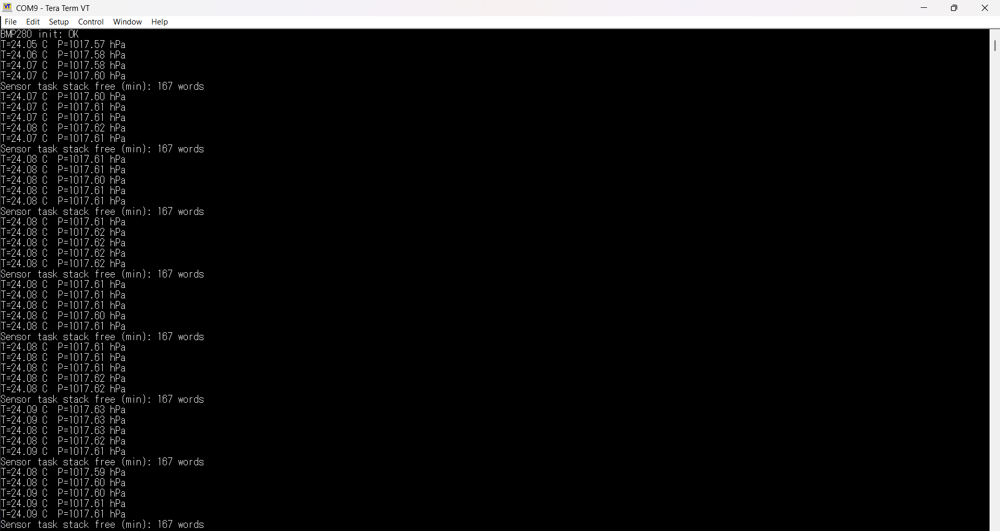
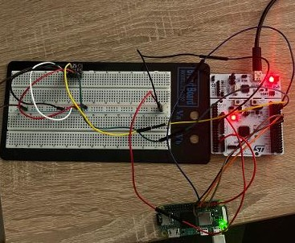
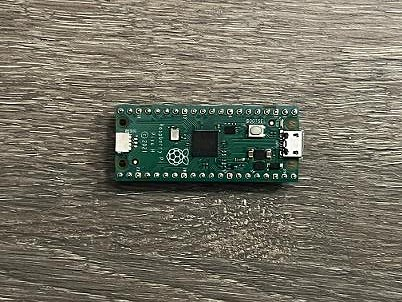
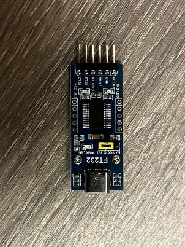
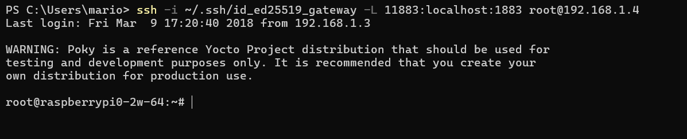
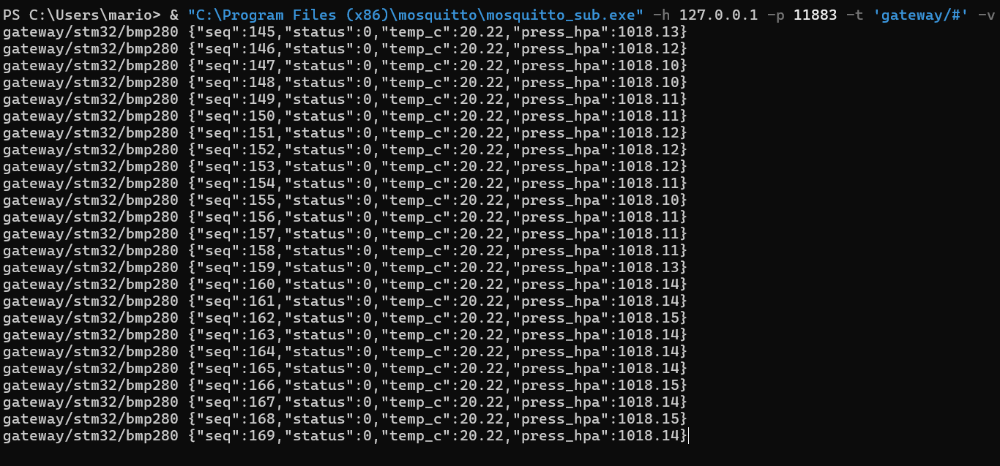
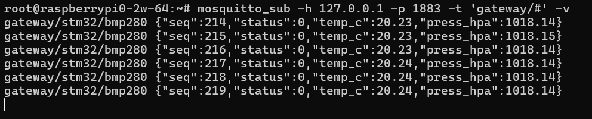

# STM32 → Embedded Linux IoT Gateway

A sensor node on an **STM32F411RE** reads a Bosch **BMP280** once a second. It runs FreeRTOS with
static allocation only, on my own register-level drivers. It offers each reading as a 14-byte,
CRC-protected frame on **SPI, fed by DMA**. A **Raspberry Pi Zero 2 W** runs a Linux image that I
built with **Yocto**. It reads the frame through **my own kernel SPI driver** and publishes it as
JSON to an **MQTT** broker on the gateway. My laptop subscribes through an SSH tunnel.

```
$ mosquitto_sub -h 127.0.0.1 -p 11883 -t 'gateway/#' -v        # on the laptop, through the tunnel
gateway/stm32/bmp280 {"seq":596,"status":0,"temp_c":20.37,"press_hpa":1016.50}
gateway/stm32/bmp280 {"seq":597,"status":0,"temp_c":20.37,"press_hpa":1016.51}
```

**Status (2026-11-02): all four phases run on the hardware.** The node, the SPI link, the custom
image, the kernel driver, the broker and the publisher work together. The publisher starts at boot.
Each part was tested on the board before the next one was built. What is **not** verified is listed
openly in [Known limitations](#known-limitations-and-what-is-not-verified) and in every ADR.

---

## Contents

- [The data path](#the-data-path)
- [Engineering practices](#engineering-practices)
- [What works, and the evidence](#what-works-and-the-evidence)
- [Design decisions (ADRs)](#design-decisions-adrs)
- [Hardware and wiring](#hardware-and-wiring)
- [Build and run](#build-and-run)
- [Known limitations and what is not verified](#known-limitations-and-what-is-not-verified)
- [Repository layout](#repository-layout)

---

## The data path

```
 BMP280 ──I2C1, 100 kHz──┐
                         ▼
 ┌────────────────────────────────────────────────────────────────────┐
 │ STM32F411RE (Nucleo, 84 MHz), FreeRTOS, static allocation only     │
 │                                                                    │
 │  sensor task (prio 1, every 1 s) ── frame ──► latest-frame queue   │
 │                                                     │              │
 │  transmit task (prio 2) ◄── notify ◄── EXTI ISR (NSS rising edge)  │
 │        │ loads the newest frame                                    │
 │        ▼                                                           │
 │  frame buffer ──DMA2 stream 3──► SPI1 data register (SPI slave)    │
 └──────────────────────────────┬─────────────────────────────────────┘
                                │ SPI mode 0, 1 MHz, chip select 0
                                ▼
 ┌────────────────────────────────────────────────────────────────────┐
 │ Raspberry Pi Zero 2 W: gateway-image (Yocto Wrynose, Linux 6.18)   │
 │                                                                    │
 │  spi-bcm2835 (driver of the Pi's SPI peripheral) + SPI core        │
 │        │                                                           │
 │  stm32_node.ko: my SPI driver, bound by my device-tree overlay     │
 │    read(): transfer, gap ≥ 200 µs, transfer, check marker + CRC    │
 │        │                                                           │
 │  /dev/stm32_sensor_node (14 checked bytes per read)                │
 │        │                                                           │
 │  gateway-publisher (C, libmosquitto): reads every 200 ms,          │
 │  publishes one JSON message per new frame                          │
 │        │ 127.0.0.1:1883 (loopback only)                            │
 │  Mosquitto broker ── topic gateway/stm32/bmp280                    │
 └──────────────────────────────┬─────────────────────────────────────┘
                                │ SSH tunnel over Wi-Fi (port 22, key only)
                                ▼
                       laptop: mosquitto_sub
```

**The frame** ([`frame.h`](firmware/stm32-sensor-node/Src/frame.h), [ADR-0010](docs/decisions/0010-spi-link-design.md)).
All multi-byte fields are little-endian:

| Bytes | Field |
|---|---|
| 0 | marker `0xA5` (a dead node reads `0x00` or `0xFF`, never `0xA5`) |
| 1 | status: 0 OK, 1 no reading yet, 2 to 6 the cause of a sensor failure |
| 2-3 | sequence number (`uint16`), +1 per frame, also while the sensor fails |
| 4-7 | temperature (`int32`, hundredths of a degree Celsius) |
| 8-11 | pressure (`uint32`, pascals) |
| 12-13 | CRC-16/CCITT-FALSE over bytes 0 to 11 |

SPI has no acknowledge and no error flag, so all the safety is in the frame. A wrong marker
means a dead node, a wrong CRC means damage, and a jump in the sequence means a lost frame.

---

## Engineering practices

These are the things that make this more than a demo. Each one has an ADR or a measurement behind it.

**Firmware (STM32)**
- **No dynamic memory.** Every FreeRTOS object is created with the static APIs. No heap is
  compiled, and the link map contains no `malloc` ([ADR-0001](docs/decisions/0001-static-memory-allocation.md)).
- **My own register-level drivers** for the clock, USART, I2C and SPI/DMA, not a vendor library
  ([ADR-0008](docs/decisions/0008-own-register-level-drivers.md)). The waits are bounded, there is one
  error code per cause, and the I2C bus recovers by itself after an error.
- **DMA for the data path.** The CPU never moves the frame's bytes. A transmit task, woken by the
  chip-select interrupt, re-arms the DMA. The re-arm is written so that a disturbed transaction cannot
  leave the node shifted by one byte. That failure was found on the board, and the fix is decision 7 of
  [ADR-0010](docs/decisions/0010-spi-link-design.md).
- **Checked on the wire** with a logic analyzer: the I2C read, the SPI frame, the SPI clock up to the
  6 MHz project limit, and the gap between reads ([`docs/captures/`](docs/captures/)).

**Gateway (Linux)**
- **A custom, minimal image**, not the stock Raspberry Pi OS. My own image recipe was built up from
  the minimum one tested step at a time: 39 MB and 82 packages, against 142 MB and 2015 packages for
  Yocto's standard `core-image-base` ([ADR-0017](docs/decisions/0017-own-image-recipe-gateway-image.md)).
  It has no Python, no systemd and no package manager.
- **A kernel driver, not a user-space `spidev` program.** A device-tree overlay attaches the driver to
  chip select 0, and udev loads it by its module alias. The driver keeps in one place the three things
  that belong in one place: the minimum gap between transfers, the "stale first read" fix, and the frame
  check. Programs get a checked frame or an error
  ([ADR-0018](docs/decisions/0018-kernel-spi-driver-and-frame-interface.md), [ADR-0019](docs/decisions/0019-stale-first-read-policy.md)).
- **MQTT adds no open port and no secret.** The broker listens on the loopback address only. I read the
  data from the laptop through my SSH login ([ADR-0021](docs/decisions/0021-mqtt-message-topic-and-access.md)).
- **Secrets stay out of the repo.** The Wi-Fi key and the root password hash are read at build time
  from a folder outside the repo. SSH accepts a key only. The build stops if the password hash is
  missing, because an image without one has a locked root account
  ([ADR-0015](docs/decisions/0015-wifi-by-hand-and-openssh.md)).
- **A service that does not trust the boot order.** The publisher starts after the broker, but it
  still waits by itself for the device file and the broker. Each failure is logged once to syslog,
  not every second ([ADR-0022](docs/decisions/0022-publisher-autostart-retry-and-logging.md)).

**Process**
- Every non-trivial choice has an ADR with the options, the reason, and what is still untested.
- Debugging is hypothesis first: what would confirm it, what would refute it, then the test. The
  failures found this way are recorded in the ADRs, not hidden.

---

## What works, and the evidence

### Phase 1: the sensor node

| What | Evidence |
|---|---|
| **84 MHz from the internal oscillator through the PLL**, in its own module, with bounded waits and build-time checks of the PLL limits. | Register values and the SysTick reload (83999) checked in the debugger. The logic analyzer measured the clock about 1.1% fast (the internal oscillator's tolerance). [ADR-0006](docs/decisions/0006-clock-hsi-pll-84mhz.md) |
| **Interrupt-driven UART** with a ring buffer. A message is stored whole or dropped whole. | Verified in Tera Term, including a burst test of the drop behaviour. |
| **I2C1 master driver at register level**, with waits bounded in RTOS ticks and self-recovery after a bus error. | Chip ID, 6-byte and 24-byte reads on the real sensor. On the wire: the read takes 834 µs, with ACK and NACK where expected. [ADR-0007](docs/decisions/0007-i2c-driver-design.md) |
| **BMP280 module** with Bosch's integer compensation (no floats, no `printf`). | Stable, plausible readings. [ADR-0009](docs/decisions/0009-bmp280-module-design.md) |
| **A sensor task that heals itself.** After any error it initialises the sensor again on the next period. | Sensor disconnected while running: `NACK` lines, then readings again, with no reset. |
| **A real failure, found and documented.** A falling edge on the sensor's CSB pin locks it out of I2C until its power is cycled. | Reproduced twice on the board. [ADR-0007](docs/decisions/0007-i2c-driver-design.md) |
| **A HardFault handler** that records the faulting PC and the fault status registers for the debugger. | A deliberate bus fault gave the expected record. |

Footprint from the last build map: about **18.5 KB of flash and 4.0 KB of RAM**, FreeRTOS included.



*Debug output on the ST-LINK virtual COM port (debug only, not part of the data path). The
`Sensor task stack free` lines came from temporary code used to measure the stack
([ADR-0005](docs/decisions/0005-task-stack-sizing.md)). That code is removed.*

### Phase 2: the SPI link

| What | Evidence |
|---|---|
| **SPI1 slave fed by DMA2.** The Pi can read at any moment, and the CPU moves no byte of the frame. | The Pi read a complete frame while the CPU was halted in the debugger. |
| **A transmit task woken by the end of each transaction**, which loads the newest frame from a one-slot queue. | 3000 reads in about 35 s: every interrupt and wake-up counted, no I2C error. |
| **A re-arm that heals itself:** the CPU writes byte 0 into the SPI data register at every re-arm. | A 50-read test found the node staying shifted after a disturbed transaction. After the fix: no shifted frame, including 10 runs stopped with Ctrl+C. |
| **Spikes on NSS are ignored** by the interrupt handler, and counted. | 7 spikes in 3000 transactions with the wires still, none damaged a frame. |
| **Long run.** | 30 minutes, 1800 reads: 1797 good, 0 shifted, 3 bad (all caught by the CRC). The node's counters agreed with the Pi. |
| **Checked on the wire** with a logic analyzer. | NSS low for exactly 112 clocks in mode 0, and a valid CRC. SCK measured 1.000 to 5.88 MHz for 1 to 6 MHz requested. Back-to-back reads leave a gap of 154 to 228 µs, and 30,000 such reads were all good. [ADR-0010](docs/decisions/0010-spi-link-design.md) |

### Phase 3: the custom Linux image

| What | Evidence |
|---|---|
| **Yocto Wrynose 6.0 (LTS), Linux 6.18.33, sysvinit and BusyBox.** Five repositories pinned to exact commits. | Boots to a login on the serial console. The Pi firmware loads the kernel directly, with no U-Boot. [ADR-0011](docs/decisions/0011-yocto-for-the-gateway-image.md), [ADR-0012](docs/decisions/0012-yocto-release-and-layer-fetching.md) |
| **My own layer `meta-gateway`** and **my own image recipe**: 39 MB root filesystem, 82 packages, 36 MB compressed. | Package manifests before and after each step. [ADR-0016](docs/decisions/0016-own-layer-meta-gateway.md), [ADR-0017](docs/decisions/0017-own-image-recipe-gateway-image.md) |
| **Wi-Fi at boot** (`nl80211`), with the key taken from a folder outside the repo. | After a flash, SSH worked with nothing typed on the board. |
| **SSH with a key only.** Root has a password for the serial console, stored as a hash only. | Without the key: `Permission denied (publickey)`. [ADR-0015](docs/decisions/0015-wifi-by-hand-and-openssh.md) |
| **Memory given back.** The GPU overlay is removed, and the reserved memory pool went from 256 MiB to 64 MiB. | Boot log: 350,660K of 458,752K available (it was 154,540K). |

### Phase 4: the kernel driver and MQTT

| What | Evidence |
|---|---|
| **Kernel SPI driver `stm32_node`.** A device-tree overlay replaces the `spidev` node on chip select 0 with mine. The SPI core matches the compatible string and calls `probe`, and udev loads the module by its alias. | `probe` line in `dmesg` at boot. After `rmmod`, re-sending the device's "add" event loaded the module again with no `modprobe`. [ADR-0018](docs/decisions/0018-kernel-spi-driver-and-frame-interface.md) |
| **`/dev/stm32_sensor_node`:** every `read()` returns a checked 14-byte frame, or `-EIO` (bad frame), or `-EINVAL` (buffer too small). | Frames read with `dd`/`hexdump`. `-EIO` with the node off. |
| **At least 200 µs between transfers**, with a mutex for concurrent readers. | 500 back-to-back reads and 8 concurrent readers: no failure. |
| **The stale first read is fixed:** every `read()` does two transfers and keeps the second. | After 30 s of idle, the sequence had moved by 30. The first read after a node reset gave `seq=3`. [ADR-0019](docs/decisions/0019-stale-first-read-policy.md) |
| **Mosquitto on the Pi, loopback only**, built without TLS and WebSocket support. | `/proc/net/tcp` shows `127.0.0.1:1883` only. [ADR-0020](docs/decisions/0020-mqtt-broker-on-the-pi-and-c-client.md) |
| **`gateway-publisher` in C:** it reads every 200 ms and publishes once per new sequence number (QoS 0, no retain). | One message per second, with no gap in `seq`. The node switched off and on, and the broker stopped and started, both recover without restarting the program. [ADR-0021](docs/decisions/0021-mqtt-message-topic-and-access.md) |
| **Starts at boot** (`S40`, after the broker's `S30`), waits for its inputs, and logs to syslog. | Reboot test with no manual command. Node powered after the Pi: `read failed`, then `read works again`. [ADR-0022](docs/decisions/0022-publisher-autostart-retry-and-logging.md) |
| **Remote access only through SSH.** | `mosquitto_sub` on the laptop received the messages through `ssh -L`. A direct connection to port 1883 was refused. |

---

## Design decisions (ADRs)

Each ADR in [`docs/decisions/`](docs/decisions/) has the options I considered, the one I chose and why,
the consequences, and what I did not verify.

| ADR | Decision |
|---|---|
| [0001](docs/decisions/0001-static-memory-allocation.md) | Static-only memory allocation for the FreeRTOS objects |
| [0002](docs/decisions/0002-freertos-port-for-arm-compiler-6.md) | The GCC/ARM_CM4F FreeRTOS port, with Arm Compiler 6 |
| [0003](docs/decisions/0003-rtos-tick-from-systemcoreclock-1khz.md) | The RTOS tick derived from `SystemCoreClock`, at 1 kHz |
| [0004](docs/decisions/0004-interrupt-priority-threshold.md) | Interrupt priority threshold for FreeRTOS calls at level 5 |
| [0005](docs/decisions/0005-task-stack-sizing.md) | Task stacks sized by measurement, with a margin |
| [0006](docs/decisions/0006-clock-hsi-pll-84mhz.md) | CPU at 84 MHz from the internal oscillator through the PLL |
| [0007](docs/decisions/0007-i2c-driver-design.md) | I2C1 driver: register-oriented API, tick-based timeouts, self-recovery |
| [0008](docs/decisions/0008-own-register-level-drivers.md) | My own register-level drivers instead of a vendor library |
| [0009](docs/decisions/0009-bmp280-module-design.md) | BMP280 module: normal mode, integer results, initialise again after every error |
| [0010](docs/decisions/0010-spi-link-design.md) | The SPI link: Pi as master, fixed frame with CRC-16, latest-frame queue, DMA re-armed on the NSS edge |
| [0011](docs/decisions/0011-yocto-for-the-gateway-image.md) | Yocto for the gateway image, not Buildroot and not the stock Raspberry Pi OS |
| [0012](docs/decisions/0012-yocto-release-and-layer-fetching.md) | Yocto Wrynose (6.0, LTS), with the layers cloned by hand |
| [0013](docs/decisions/0013-accept-the-wifi-firmware-license.md) | Accept the license flag of the Wi-Fi firmware |
| [0014](docs/decisions/0014-skip-the-buildpaths-check-for-perl.md) | Skip one quality check for the `perl` recipe (a workaround; cause not found) |
| [0015](docs/decisions/0015-wifi-by-hand-and-openssh.md) | OpenSSH, the Wi-Fi key and root password kept outside the repo, key-only SSH |
| [0016](docs/decisions/0016-own-layer-meta-gateway.md) | My own layer `meta-gateway`: Wi-Fi starts at boot, with `nl80211` |
| [0017](docs/decisions/0017-own-image-recipe-gateway-image.md) | My own image recipe `gateway-image`, built up from the minimum in tested steps |
| [0018](docs/decisions/0018-kernel-spi-driver-and-frame-interface.md) | A kernel SPI driver with a character device that returns the raw, checked frame |
| [0019](docs/decisions/0019-stale-first-read-policy.md) | The stale first read is handled in the driver by reading twice |
| [0020](docs/decisions/0020-mqtt-broker-on-the-pi-and-c-client.md) | Mosquitto broker on the Pi, and a C publisher with libmosquitto |
| [0021](docs/decisions/0021-mqtt-message-topic-and-access.md) | JSON message, topic, publish rule, error handling, broker on loopback only |
| [0022](docs/decisions/0022-publisher-autostart-retry-and-logging.md) | The publisher starts from an init script, waits for its inputs, and logs to syslog |

---

## Hardware and wiring



*The setup I used for the tests: the Raspberry Pi Zero 2 W, the breadboard with the BMP280 and the Nucleo-F411RE, joined by jumper wires.*

- STM32 Nucleo-F411RE (Cortex-M4F, run at 84 MHz, 128 KB SRAM)
- Bosch BMP280 breakout (temperature and pressure, I2C)
- Raspberry Pi Zero 2 W (Cortex-A53, 512 MB RAM, Wi-Fi)
- Logic analyzer: a Raspberry Pi Pico with the `sigrok-pico` firmware, read in PulseView
- A USB-UART adapter (3.3 V) for the Pi's serial console

|  |  |
|:---:|:---:|
| *The Raspberry Pi Pico, the logic analyzer (`sigrok-pico` firmware)* | *The FT232 USB-UART adapter, for the Pi's serial console* |

### BMP280 to Nucleo

| BMP280 | Nucleo |
|---|---|
| VCC | 3V3 |
| GND | GND |
| SCL | PB8 |
| SDA | PB9 |
| SDO | GND (address 0x76) |
| **CSB** | **3V3, wired firmly** |

CSB must stay high. A falling edge on it, even from a loose wire, switches the sensor to SPI mode
until its power is cycled ([ADR-0007](docs/decisions/0007-i2c-driver-design.md)).

### Raspberry Pi to Nucleo (SPI)

Both sides are 3.3 V. There are only these five wires, and no power wire between the boards.

| Signal | Pi header pin | Nucleo pin |
|---|---|---|
| NSS (chip select) | 24 (CE0, GPIO8) | PA4 (A2) |
| SCK | 23 (GPIO11) | PA5 (D13) |
| MISO | 21 (GPIO9) | PA6 (D12) |
| MOSI | 19 (GPIO10) | PA7 (D11) |
| GND | 25 | GND |

Keep the wires short. Wires that disturb the link, such as probe wires clipped onto the SPI lines,
create spikes on NSS ([ADR-0010](docs/decisions/0010-spi-link-design.md)).

---

## Build and run

### 1. The sensor node (Windows, Keil)

Needed: **Keil MDK-ARM** with Arm Compiler 6 (I used armclang V6.24), the device pack
`Keil.STM32F4xx_DFP.2.17.0`, and a Nucleo-F411RE on USB.

1. Open `firmware/stm32-sensor-node/stm32-sensor-node.uvprojx`.
2. Build, then download to the board. FreeRTOS V11.3.1 is in the repo, unmodified. The project's
   configuration is in `FreeRTOS/config/FreeRTOSConfig.h`.
3. Optional: open the ST-LINK virtual COM port at **115200, 8N1** to see the debug output:

```
BMP280 init: OK
T=24.08 C  P=1017.61 hPa
```

### 2. The gateway image (Linux, Yocto)

I build in WSL2 (Ubuntu 24.04). The Yocto repositories and the build folder stay **outside** this
repo, in `~/yocto/`, next to each other. [`linux-gateway/`](linux-gateway/) holds only my files:
the build configuration (`conf/`) and my layer (`meta-gateway/`).

1. Clone the five repositories into `~/yocto/` at the commits listed in
   [`docs/architecture.md`](docs/architecture.md#gateway-image-phase-3-built-booted-reachable-over-wi-fi-and-ssh):
   `bitbake`, `openembedded-core`, `meta-yocto`, `meta-raspberrypi`, `meta-openembedded`.
2. `source ~/yocto/openembedded-core/oe-init-build-env ~/yocto/build`, copy `meta-gateway/` to
   `~/yocto/meta-gateway`, and replace the generated `conf/bblayers.conf` and `conf/local.conf` with
   the ones from `linux-gateway/conf/`.
3. Create `~/yocto/secrets/` with your Wi-Fi file and a root password hash, as described in
   [`linux-gateway/README.md`](linux-gateway/README.md). These secrets are never committed.
4. `bitbake gateway-image`, then flash the `.wic.bz2` from
   `build/tmp/deploy/images/raspberrypi0-2w-64/` to a microSD card.

The finished image contains the Wi-Fi key and the password hash, so it must not be shared. 

### 3. Reading the data

The publisher starts by itself at boot. On the Pi:

```sh
mosquitto_sub -t 'gateway/#' -v                  # the messages
grep gateway-publisher /var/log/messages         # the publisher's log
```

From a laptop, through an SSH tunnel (the broker is not reachable on the network otherwise):

```sh
ssh -i <your key> -L 11883:localhost:1883 root@<pi address>      # window A, keep it open
mosquitto_sub -h 127.0.0.1 -p 11883 -t 'gateway/#' -v            # window B
```

Both ways on the real board:



*Window A, on the laptop: the SSH login with `-L 11883:localhost:1883`. The "Last login" date is not
real, because the Pi has no clock. The warning is the standard banner of the Poky distribution.*



*Window B, on the laptop (Windows): `mosquitto_sub` connects to its own port 11883, and the tunnel
carries it to the broker on the Pi. One message per second, `seq` 145 to 169, `status` 0.*



*On the Pi itself: the same subscriber, straight to the broker on port 1883.*

---

## Known limitations and what is not verified

I keep this list honest. Each item is also in [`docs/architecture.md`](docs/architecture.md) or an ADR.

- **The node's re-arm time is not measured.** Only an upper bound (154 µs) is known. The driver's
  200 µs gap is a margin above it, but neither the gap nor the 1 MHz clock has been captured on the
  wire with the kernel driver.
- **Nothing restarts the publisher if it crashes.** Tested with `kill -9` on the board: it stays dead.
  The shutdown order (publisher before broker) was read from the `rc` links, not watched on the board.
- **The root filesystem is writable**, and `/boot` is mounted read-write. A power cut during a write
  could damage it. A product would need a read-only root; I decided not to do it here, and the reasons
  are in the change log of `docs/architecture.md`.
- **Secrets are inside every image.** Anyone with the SD card can read the Wi-Fi key and the password
  hash.
- **No clock on the Pi** (no battery, no network time). Log dates are not real, and TLS is not
  possible yet. That is one reason why the broker stays on the loopback address.
- **Smaller open items:** the cause of the NSS spikes the firmware counts, the UART bit time, and why
  the `perl` recipe needs a workaround ([ADR-0014](docs/decisions/0014-skip-the-buildpaths-check-for-perl.md)).

---

## Repository layout

```
firmware/stm32-sensor-node/      Keil project (Phases 1-2)
  Src/                           main, clock, uart, i2c, bmp280, format, frame, spi,
                                 sensor_task, transmit_task, hardfault, freertos_callbacks
  FreeRTOS/                      kernel V11.3.1 (unmodified) and the project's config
linux-gateway/                   Phases 3-4: what I wrote for the gateway (README inside)
  conf/                          bblayers.conf and local.conf of the build
  meta-gateway/                  my Yocto layer
    recipes-core/images/         gateway-image.bb: the image recipe
    recipes-kernel/stm32-node/   the kernel SPI driver (stm32_node.c)
    recipes-bsp/                 the device-tree overlay and the config.txt change
    recipes-app/                 gateway-publisher (C) and its init script
    recipes-connectivity/        Mosquitto config, Wi-Fi changes
    recipes-test/                spi-frame-test, the bring-up tool before the driver existed
docs/
  architecture.md                the current state of the system, with evidence (living document)
  decisions/                     the 22 ADRs
  captures/                      logic analyzer captures, the screenshots and photos of the hardware (README inside)
  plan.md                        the original plan of the project (in Greek)
  budget.md                      hardware cost tracking
tools/
  spi_frame_test.py              the Phase 2 test tool (Python, on the stock Raspberry Pi OS)
```
