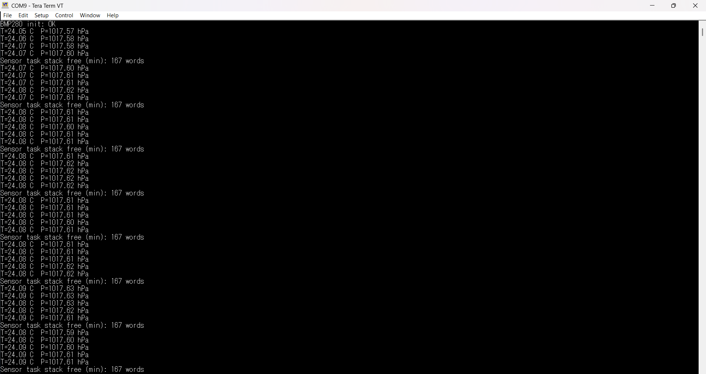

# STM32 → Embedded Linux IoT Gateway

A sensor node on an **STM32F411RE** (FreeRTOS, static allocation only, my own
register-level drivers) that reads a **BMP280** over I2C once a second and sends the
reading, as a CRC-protected frame, over **SPI with DMA** to a **Raspberry Pi Zero 2 W**.
The next step is a custom-built Linux image on the Pi, where a kernel driver hands
the data to an MQTT publisher.

**Status: Phases 1 and 2 work on the board.** The Pi (running the stock Raspberry Pi
OS as a temporary test jig) reads a valid frame every second. The Phase 3 image boots on the
board, joins my Wi-Fi by itself (the key is baked in from a file outside the repo), I can log
in over SSH, and a test tool in the image (`spi-frame-test`) reads valid frames from the
STM32 over SPI. The image is my own recipe, built up from the minimum: 37 MB root filesystem
and 76 packages, against 142 MB and 2015 for the standard `core-image-base`. **Still to come:
SSH keys and the rest of the clean-up for Phase 3, and Phase 4.**
The logic analyzer captures of
Phase 2 are done, apart from the re-arm time and the UART bit time.
The file `docs/architecture.md` describes the real current state, and I keep it
honest: what is verified, and what is not.

This is a learning project built to prepare for embedded software and embedded
Linux roles. The goal is not only a working system but to be able to defend every
design decision, which is why the reasoning is written down in ADRs.



*Tera Term on the ST-LINK virtual COM port. The `Sensor task stack free` lines
come from temporary code that I used to measure the task's stack (ADR-0005); it is
removed now, so the node prints only the init line and the readings.*

## What works today

### Phase 1: the sensor node

| What | Evidence |
|---|---|
| **Static allocation only.** No `heap_x.c` is compiled, and `configSUPPORT_DYNAMIC_ALLOCATION` is 0. | The link map contains no `malloc` (the only match is the library function `_get_argv_nomalloc`). ADR-0001 |
| **84 MHz from the internal oscillator through the PLL**, in its own module with bounded waits and build-time checks of the PLL limits. | Register values and the SysTick reload (83999) checked in the debugger. ADR-0006 |
| **Interrupt-driven UART** with a ring buffer. A message is stored whole or dropped whole. | Verified in Tera Term, including a burst test of the drop behaviour. |
| **I2C1 master driver at register level.** Waits bounded in RTOS ticks, one error code per cause, a critical section only around the few operations with a deadline, and self-recovery after a bus error. | Chip ID, 6-byte and 24-byte reads on the real sensor. ADR-0007 |
| **BMP280 module** with Bosch's integer compensation (no floats, no `printf`). | Stable, plausible readings (see the screenshot). ADR-0009 |
| **Self-healing sensor task.** After any error the task initialises the sensor again on the next period. | Disconnected the sensor completely while it ran: `NACK` lines, then `OK` and readings again, with no reset. |
| **A real failure found and documented.** A falling edge on the sensor's CSB pin locks it out of I2C until its power is cycled. | Reproduced twice on the board. ADR-0007 |
| **A HardFault handler** that records the stacked registers (the PC of the faulting instruction) and the fault status registers where the debugger can read them, and **no heap** (the start-up heap is 0 bytes; nothing allocates). | A deliberate bus fault gave the expected record; the map no longer has the 512-byte heap. |

### Phase 2: the SPI link to the gateway (ADR-0010)

| What | Evidence |
|---|---|
| **A 14-byte frame** per second: marker, status, sequence number, temperature, pressure, CRC-16. SPI has no acknowledge and no error flag, so the safety is in the frame. | The bytes of the C code equal a Python replica, in the debugger and read by the Pi. |
| **SPI1 as a slave, fed by DMA.** The bytes are moved by DMA2, not by the CPU; the Pi can read at any moment. | The Pi read a complete frame while the CPU was halted in the debugger. |
| **A transmit task woken by the end of each transaction** (interrupt on the NSS rising edge, a task notification) that loads the newest frame. The sensor task hands frames over through a one-slot queue. | 3000 reads in about 35 s with the node running freely: every interrupt and wake-up counted, no I2C error on the sensor task. |
| **A re-arm that heals itself.** At every re-arm the CPU writes byte 0 into the SPI data register, so a short or interrupted transaction cannot leave the node shifted. | A failure I found with a 50-read test (the node stayed shifted by one byte) and fixed. After the fix: a deliberate short read, then a correct frame; 47 good of 50 reads while I moved the wires, none shifted. |
| **Spikes on NSS are ignored** by the interrupt handler (it reads the pin before believing the edge) and counted. | With the wires still: 7 spikes in 3000 transactions, no damaged frame. While touching the wire: about 3000 spikes, 3017 ignored. |
| **Range.** | SPI clock from 100 kHz to 6 MHz, and reads back to back from Python: all good, apart from the rare noise-damaged frame, always followed by good ones. |
| **A sensor failure reaches the Pi.** | With SDA unplugged: frames with status `NACK` and zeros, then `NO_READING`, then `OK`; the sequence kept counting. |
| **Checked on the wire** with a logic analyzer (a Raspberry Pi Pico with `sigrok-pico`, read in PulseView). | NSS low during exactly 112 SCK clocks in SPI mode 0, and the frame decodes with a valid CRC. SCK measured 1.000, 2.000, 3.997 and 5.88 MHz for 1, 2, 4 and 6 MHz requested. NSS stays high 154 to 228 us between back-to-back reads from Python, and 30000 such reads were all good. The BMP280 read on I2C and the CPU clock (about 1.1% fast) were measured too. `docs/captures/`, ADR-0006, ADR-0007, ADR-0010 |

Size from the last build map (2026-10-17): about 18.5 KB of flash and 4.0 KB of RAM (of
128 KB), FreeRTOS included.

### What is not verified, or not done

- **The logic analyzer works and has captured the I2C and SPI links**
  (`docs/captures/`, ADR-0006, ADR-0010): the BMP280 read and the 14-byte SPI frame are as
  designed, the clock runs about 1.1% fast, SCK is within the 6 MHz limit (5.88 MHz at the
  top setting), and 30000 back-to-back reads from the Pi were all good. Still open: the
  re-arm time (only an upper bound of 154 us), the cause of the spikes the firmware counts
  on NSS (none were seen with a clean probe wiring), and the UART bit time.
- The first read after an idle time returns a stale frame (as old as the idle time):
  fine for a poller that reads every period, to be decided with the Phase 4 driver.
- The Pi side is the stock Raspberry Pi OS with Python `spidev`: a temporary test jig,
  not the final image.
- A sensor locked out by CSB needs a power cycle, which no I2C driver can fix.

## Architecture

What runs today:

```
 BMP280 ──I2C1 (PB8 SCL, PB9 SDA)──┐
                                    ▼
        ┌─────────────────────────────────────────────────────────────┐
        │ STM32F411RE (Nucleo, 84 MHz), FreeRTOS, static allocation   │
        │                                                             │
        │  Sensor task (prio 1, 1 s) ──frame──► latest-frame queue    │
        │       │                                    │ xQueuePeek     │
        │       └─ lines ─► USART2 (PA2) ─► ST-LINK  │                │
        │                   virtual COM, Tera Term   ▼                │
        │  Transmit task (prio 2) ◄─ notify ◄─ EXTI4 ISR (NSS rising) │
        │       │ spi_load_frame()                                    │
        │       ▼                                                     │
        │  ucDmaFrame ──DMA2 stream 3──► SPI1->DR  (SPI1 slave)       │
        └───────────────────────────────────────────┬─────────────────┘
                              PA4 NSS, PA5 SCK, PA6 MISO, PA7 MOSI │
                                                                    ▼
                                       Raspberry Pi Zero 2 W (SPI master, test jig)
```

The plan (Phases 3 and 4):

```
   STM32 sensor node ──SPI + DMA──► Raspberry Pi Zero 2 W ──► kernel driver ──► MQTT ──► network
                                    (custom Linux image)     (Device Tree)
```

## Design decisions

Every non-trivial choice has an ADR in `docs/decisions/`, with the options I
considered, the one I chose and why, and what I did not verify.

| ADR | Decision |
|---|---|
| 0001 | Static-only memory allocation for the FreeRTOS objects |
| 0002 | The GCC/ARM_CM4F FreeRTOS port, with Arm Compiler 6 |
| 0003 | The RTOS tick derived from `SystemCoreClock`, at 1 kHz |
| 0004 | Interrupt priority threshold for FreeRTOS calls at level 5 |
| 0005 | Task stacks sized by measurement, with a margin |
| 0006 | CPU at 84 MHz from the HSI through the PLL, in its own module |
| 0007 | I2C1 driver: register-oriented polling API with tick-based timeouts and self-recovery |
| 0008 | Own register-level drivers instead of a vendor library |
| 0009 | BMP280 module: normal mode, integer results, initialise again after every error |
| 0010 | The SPI link: the Pi as master, a fixed frame with CRC-16, a one-slot latest-frame queue, a transmit task re-arming a normal-mode DMA on the NSS edge; the CPU primes the data register; NSS spikes ignored |
| 0011 | Yocto for the gateway image, not Buildroot and not the stock Raspberry Pi OS |
| 0012 | Yocto Wrynose (6.0, LTS), with the layers cloned by hand |
| 0013 | Accept the `synaptics-killswitch` license flag to get the Wi-Fi firmware |
| 0014 | Skip the `buildpaths` quality check for the `perl` recipe (a workaround; the cause is not found) |
| 0015 | Wi-Fi typed on the board for now, OpenSSH as the SSH server, and the first OpenSSH build that shipped seven 0-byte programs |
| 0016 | A layer of my own (`meta-gateway`) that replaces `/etc/network/interfaces`: Wi-Fi starts at boot, with `nl80211` |
| 0017 | An image recipe of my own (`gateway-image`), built up from the minimum in tested steps: 142 MB and 2015 packages down to 37 MB and 76 |

## Hardware

- STM32 Nucleo-F411RE (Cortex-M4 at 84 MHz, 128 KB SRAM)
- Bosch BMP280 breakout (temperature and pressure, I2C)
- Raspberry Pi Zero 2 W: today the SPI master of the test (stock Raspberry Pi OS Lite,
  Python `spidev`), later the target of the custom Linux image (Phase 3)
- A logic analyzer for Phase 2 (a Raspberry Pi Pico with the `sigrok-pico` firmware,
  read with `PulseView`): used for the I2C and SPI captures in `docs/captures/`

The extra hardware budget is 50 EUR. See `docs/budget.md`.

### Wiring the BMP280

| BMP280 | Nucleo |
|---|---|
| VCC | 3V3 |
| GND | GND |
| SCL | PB8 |
| SDA | PB9 |
| SDO | GND (address 0x76) |
| **CSB** | **3V3, wired firmly** |

CSB must stay high. A falling edge on it, even a loose wire, switches the sensor to
SPI mode until its power is cycled (see ADR-0007). Most breakouts already have
pull-ups on SCL and SDA; the firmware also enables the weak internal ones as a backup.

### Wiring the Raspberry Pi (SPI)

Both sides are 3.3 V; only these five wires, and no power between the boards.

| Signal | Pi header pin | Nucleo pin |
|---|---|---|
| NSS (chip select) | 24 (CE0, GPIO8) | PA4 (A2) |
| SCK | 23 (GPIO11) | PA5 (D13) |
| MISO | 21 (GPIO9) | PA6 (D12) |
| MOSI | 19 (GPIO10) | PA7 (D11) |
| GND | 25 | GND |

The Nucleo pins and their Arduino labels are those of the Nucleo-64 manual (UM1724,
Table 16); the Pi pins are its standard SPI0 pins. This is the wiring used in all the
tests. Keep the wires short: wires that disturb the link, such as probe wires clipped
onto the SPI lines, create spikes on NSS (ADR-0010).

## Build and run

Needed:
- **Keil MDK-ARM** with Arm Compiler 6 (I used armclang V6.24) and the device pack
  `Keil.STM32F4xx_DFP.2.17.0`
- A Nucleo-F411RE connected over USB (the ST-LINK flashes it and provides the serial port)
- A serial terminal, for example Tera Term
- For the SPI link: a Raspberry Pi with SPI enabled (`sudo raspi-config nonint do_spi 0`)
  and `python3-spidev`

Steps:
1. Open `firmware/stm32-sensor-node/stm32-sensor-node.uvprojx` in Keil.
2. Build, then download to the board. FreeRTOS V11.3.1 is in the repository,
   unmodified; the project's own configuration is in
   `FreeRTOS/config/FreeRTOSConfig.h`.
3. Open the ST-LINK virtual COM port in the terminal at **115200, 8N1**.
4. On the Pi, copy `tools/spi_frame_test.py` and run
   `python3 spi_frame_test.py poll --count 10 --period 1.0 --verbose`.

Expected output in the terminal:

```
BMP280 init: OK
T=24.08 C  P=1017.61 hPa
T=24.08 C  P=1017.61 hPa
...
```

If the sensor is disconnected, you get `BMP280 error: NACK (failures: n)` every
second, and the readings come back by themselves when it is reconnected.

Expected output on the Pi (the first read of a run can be stale or the placeholder
with sequence 0, see above; the others are consecutive):

```
   0 ok  seq=412 status=OK T=21.35 C P=1017.20 hPa
   1 ok  seq=413 status=OK T=21.35 C P=1017.21 hPa
   ...
poll 1000000 Hz           good    10  shifted    0  bad    0  seq-jumps   1  [OK:10]
```

(The numbers above are an example of the format, not a recording.)

## Roadmap

| Phase | What | State |
|---|---|---|
| 1 | Hardware and RTOS: I2C driver, BMP280, FreeRTOS with static allocation | Working on the board |
| 2 | SPI + DMA transfer to the gateway, checked with a logic analyzer | Working and checked on the wire; the re-arm time and the UART bit time are not measured |
| 3 | Custom minimal Linux image for the Raspberry Pi Zero 2 W (Yocto, ADR-0011) | The image builds (2008 packages, 79 MB compressed) and boots; Wi-Fi (typed by hand) and SSH work; no SPI yet |
| 4 | Linux kernel SPI driver, Device Tree overlay, MQTT publishing | Not started |

Practices that belong to the later phases (a custom Linux image, a kernel driver
instead of `spidev`, protocol-level debugging with a logic analyzer) are goals, not
achievements, until they exist.

## Repository layout

```
firmware/stm32-sensor-node/   Keil project
  Src/                        main, clock, uart, i2c, bmp280, format, frame, spi,
                              sensor_task, transmit_task, hardfault, freertos_callbacks
  FreeRTOS/                   kernel V11.3.1 (unmodified) and the project's config
docs/
  architecture.md             the current state of the system (living document)
  decisions/                  Architecture Decision Records
  captures/                   the Phase 1 screenshot and the logic analyzer captures (README inside)
  budget.md                   hardware cost tracking
  plan.md                     the original plan of the whole project (in Greek)
tools/
  spi_frame_test.py           runs on the Pi: reads and checks the frames
```

`linux-gateway/` holds the Yocto configuration of the gateway image (`conf/`), my own layer
(`meta-gateway/`, ADR-0016) and how to rebuild it.
